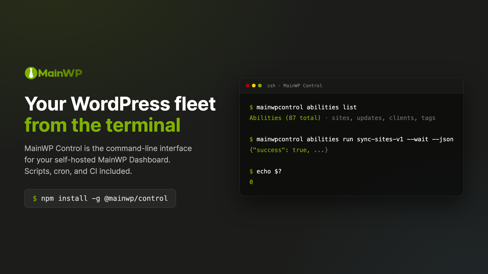

<p align="center">
  
</p>

<p align="center">
  <strong>Run updates, syncs, backups, and health checks across every WordPress site in your MainWP Dashboard from scripts, cron, and CI.</strong>
</p>

<p align="center">
  <a href="https://mainwp.com/mainwp-tools/mainwp-control/">Website</a> ·
  <a href="https://mainwp.com/mainwp-ai/">MainWP AI</a> ·
  <a href="https://docs.mainwp.com/api-reference/mainwp-control">Documentation</a> ·
  <a href="https://github.com/mainwp/mainwp-control/tree/main/docs/workflows">Workflows</a> ·
  <a href="https://community.mainwp.com/">Community</a> ·
  <a href="https://mainwpinvite.com/">Discord</a> ·
  <a href="https://mainwp.com/mainwp-support/">Support</a>
</p>

<p align="center">
  <a href="https://www.npmjs.com/package/@mainwp/control"></a>
  <a href="https://github.com/mainwp/mainwp-control/actions/workflows/ci.yml"></a>
  <a href="https://github.com/mainwp/mainwp-control/blob/main/LICENSE"></a>
</p>

# MainWP Control

[MainWP Control](https://mainwp.com/mainwp-tools/mainwp-control/) (`@mainwp/control`) is the official command-line interface for your self-hosted MainWP Dashboard. It is built for WordPress professionals and agencies who want weekly checks, backups, and update rounds running reliably on a schedule instead of in a browser tab:

```bash
# Which sites have pending updates?
mainwpcontrol abilities run list-updates-v1 --json

# Sync every site and wait for it to finish
mainwpcontrol abilities run sync-sites-v1 --wait --json

# Nightly from cron: alert Slack if any site is disconnected
mainwpcontrol abilities run list-sites-v1 \
  --input '{"status":"disconnected","per_page":1}' --json \
  | jq -e '.data.data.total == 0' >/dev/null \
  || curl -fsS "$SLACK_WEBHOOK" -d '{"text":"Sites need attention"}'
```

MainWP Control runs on your own computer, server, or CI runner and connects straight to your Dashboard over HTTPS, with no MainWP service in between. Your client sites keep running the MainWP Child plugin they already have, with no extra plugins to install. Destructive actions such as updates, restores, and deletions show a readable plan first and wait for your explicit confirmation.

<p align="center">
  
</p>

## Pick the right tool for the job

All three free MainWP tools connect to the same WordPress Abilities API on your MainWP Dashboard with preview-and-confirm guardrails:

| Tool | Best for | Where it runs |
| --- | --- | --- |
| **MainWP Control** *(this package)* | Cron jobs, shell scripts, CI/CD pipelines, monitoring agents, and repeatable batch runs with structured JSON and exit codes (plus optional terminal chat) | Your computer, server, or CI runner |
| **[MainWP MCP](https://github.com/mainwp/mainwp-mcp)** | Conversational site management in Claude, ChatGPT, Cursor, VS Code Copilot, or OpenAI Codex | Local `@mainwp/mcp` server, or [a direct connection to your Dashboard](https://docs.mainwp.com/mcp-server/remote/overview) over HTTPS |
| **[MainWP Assistant](https://docs.mainwp.com/dashboard/mainwp-assistant/overview)** | Quick MainWP documentation answers (with no AI key) and site checks inside your Dashboard | **Assistant** in your Dashboard sidebar |

## Quick Start

### Requirements

- **MainWP Dashboard 6.4.2 or later** on **WordPress 6.9 or later**, reachable over HTTPS
- **MainWP Child** on your client sites
- **Node.js 20.18.1 or later** (macOS, Linux, Windows, or CI runners)

> **On Windows?** Use [Git Bash](https://gitforwindows.org/) to run every example below as written. For scheduled jobs, use [WSL](https://learn.microsoft.com/en-us/windows/wsl/install) or GitHub Actions.

### Guided setup or manual setup

In your MainWP Dashboard, open **AI > MainWP Control** for a guided four-step setup that creates an Application Password and gives ready-to-copy install and test commands. To configure from the terminal directly:

**1. Create an Application Password.** In your Dashboard, open **API Access > Application Passwords** (or **Users > Profile > Application Passwords** in WordPress admin), add one named "MainWP Control", and copy it right away. A dedicated WordPress user for automation keeps your audit trail clean and its access easy to revoke.

**2. Install and sign in.**

```bash
npm install -g @mainwp/control

mainwpcontrol login
```

`login` prompts for your Dashboard URL, username, and Application Password, then stores the credential in your OS keychain. For CI and headless servers, use [environment variable auth](https://github.com/mainwp/mainwp-control/blob/main/docs/configuration.md#environment-variable-auth).

**3. Discover abilities and run your first check.**

```bash
mainwpcontrol abilities list --category mainwp-sites
```

```text
Abilities (30 total)

  mainwp-sites
Name                  Description        Type
--------------------  -----------------  ---------
mainwp/list-sites-v1  List MainWP Sites  📖 read
    mainwpcontrol abilities run list-sites-v1
mainwp/get-site-v1    Get MainWP Site    📖 read
    mainwpcontrol abilities run get-site-v1 --input '{"site_id_or_domain":1}'
mainwp/sync-sites-v1  Sync MainWP Sites  ✏️  write
    mainwpcontrol abilities run sync-sites-v1
...
```

Run `mainwpcontrol abilities list` on its own to see every core and active add-on ability on your Dashboard, with its read, write, or destructive label and exact run command. Try a read-only check right away:

```bash
mainwpcontrol abilities run list-sites-v1 --json
```

> **New to the command line?** [Getting Started](https://github.com/mainwp/mainwp-control/blob/main/docs/getting-started.md) covers terminals, npm, Application Passwords, environment variables, and JSON quoting.

## Why a CLI for your WordPress network?

Your MainWP Dashboard UI is built for hands-on sessions. MainWP Control is built for repeatable care-plan routines that run unattended and protect your client sites:

- **Scriptable JSON output.** `--json` prints one clean envelope on stdout while progress and warnings stay on stderr, ready to pipe straight into `jq`, a spreadsheet, or a monitoring agent.
- **Predictable exit codes.** Outcomes map to exit codes `0` through `5` by error class (input, auth, network, API, internal), plus standard signal exits (`130` and `143`), so pipelines branch cleanly on status codes.
- **Resumable batch jobs.** Large multi-site operations queue on your Dashboard and return a `job_id`. Pass `--wait` or run `mainwpcontrol jobs watch <job-id>` to follow progress or reconnect to a running job later.
- **Readable previews before changes.** `--dry-run` prints the plan site by site: each version change, anything held back, and the backup check result, with errors and warnings from your Dashboard at the top. Every confirmed run is written to a local audit log.
- **Credentials bound to your Dashboard.** Interactive logins store your Application Password in your OS keychain (macOS Keychain, Windows Credential Manager, or Linux libsecret). Headless and CI jobs pair `MAINWP_APP_PASSWORD` with `MAINWP_DASHBOARD_URL` so credentials stay scoped to your named Dashboard.

## Everyday commands

```bash
# Check for pending updates across all sites
mainwpcontrol abilities run list-updates-v1 --json

# Get details for one site
mainwpcontrol abilities run get-site-v1 --input '{"site_id_or_domain": 1}' --json

# Preview a destructive action first; nothing changes until you pass --confirm
mainwpcontrol abilities run delete-site-v1 \
  --input '{"site_id_or_domain": "mysite.com"}' \
  --dry-run --json

# Preview plugin updates, then confirm and wait for completion
# (--force skips the interactive prompt in CI while keeping preview validation)
mainwpcontrol abilities run update-site-plugins-v1 \
  --input '{"site_id_or_domain": 1}' --dry-run --json
mainwpcontrol abilities run update-site-plugins-v1 \
  --input '{"site_id_or_domain": 1}' --confirm --force --wait --json

# Inspect the input schema and safety annotations for any ability
mainwpcontrol abilities info update-site-plugins-v1

# Check configuration, credentials, and Dashboard connectivity
mainwpcontrol doctor
```

Managing more than one Dashboard? Each `login` saves a profile named after its hostname. Switch defaults with `mainwpcontrol profile use <name>` or target one per command with `--profile <name>`. See the [CLI Reference](https://github.com/mainwp/mainwp-control/blob/main/docs/cli-reference.md#profile).

> **Using Windows PowerShell?** Put JSON parameters in a file and pass `--input-file` for consistent quoting across shells. See [Input from File](https://github.com/mainwp/mainwp-control/blob/main/docs/workflows/input-from-file.md).

## What you can automate

Your MainWP Dashboard registers over 100 core abilities across ten categories in the free MainWP Core, plus abilities from active MainWP add-ons. MainWP Control discovers them at runtime, so new abilities are ready as soon as your Dashboard has them, with no CLI update:

- **Sites (`mainwp-sites`):** list, count, sync, check connectivity, add, update, reconnect, suspend, or remove child sites; inspect security, changes, and site costs; manage installed or abandoned plugins and themes, activate or deactivate plugins, switch themes, and delete retired ones ([Sites Abilities](https://docs.mainwp.com/api-reference/abilities-api/sites))
- **Built-In Backups (`mainwp-backups`):** check backup status and history, run backups, manage backup tasks, snapshots, and storage destinations, and monitor or roll back restores ([Backup Abilities](https://docs.mainwp.com/api-reference/abilities-api/backups))
- **Updates (`mainwp-updates`):** list pending core, plugin, theme, and translation updates, manage ignored updates, and preview and apply updates on one site or across your network ([Updates Abilities](https://docs.mainwp.com/api-reference/abilities-api/updates))
- **Clients (`mainwp-clients`):** manage client records, site assignments, and client status, and view read-only client costs when Cost Tracker is active ([Clients Abilities](https://docs.mainwp.com/api-reference/abilities-api/clients))
- **Tags (`mainwp-tags`):** create, update, and delete tags, and list tagged sites and clients ([Tags Abilities](https://docs.mainwp.com/api-reference/abilities-api/tags))
- **Knowledge (`mainwp-knowledge`):** read and manage Agency, Client, and Site Context, Skills, and Memory records ([MainWP Knowledge](https://docs.mainwp.com/dashboard/overview/mainwp-knowledge))
- **Insights, Fleet, and Monitoring (`mainwp-insights`, `mainwp-fleet`, `mainwp-monitoring`):** pull uptime stats and downtime incidents, query Network Activity logs and summaries, view upcoming renewals when Cost Tracker is active, and check WordPress, PHP, and MySQL versions across your sites ([Abilities API Overview](https://docs.mainwp.com/api-reference/abilities-api/overview))
- **Batch Operations (`mainwp-batch`):** poll and resume queued multi-site jobs ([Batch Operations](https://docs.mainwp.com/api-reference/abilities-api/batch-operations))
- **Chat mode (optional):** query your Dashboard in plain English from the terminal using your own Anthropic, OpenAI, Google Gemini, or OpenRouter key, or a local model, through the same preview-and-confirm safety path ([Chat Mode](https://github.com/mainwp/mainwp-control/blob/main/docs/chat.md))

Run `mainwpcontrol abilities list` to inspect every ability on your Dashboard, `mainwpcontrol abilities info <name>` to see its input schema and annotations, and `mainwpcontrol abilities run <name>` to execute it.

## Safety and previews

Every ability carries annotations classifying it as read, write, or destructive, backed by a conservative name-based override for deletions, updates, restores, and rollbacks. Destructive operations run in two steps:

1. **`--dry-run`** previews what your MainWP Dashboard reports will change. Update previews list each site's version changes, held-back items, and backup check result. A preview for one site, tag, or client names it. Errors and warnings from your Dashboard come first.
2. **`--confirm`** runs a fresh preview first and executes once that preview succeeds. Each confirmed run is written to a local audit log before it is sent.

Validated pipelines can pass `--confirm --force` per command to skip the interactive prompt while keeping preview checks and audit logging active. Chat mode runs through the same execution path, so a model can propose a destructive change and you confirm it in your terminal. Full details live in [Safety & Destructive Operations](https://github.com/mainwp/mainwp-control/blob/main/docs/safety.md).

## Configuration for CI and headless runners

Interactive use works right after `mainwpcontrol login`. For CI, Docker, and headless machines, supply your Application Password and its matching Dashboard URL through environment variables:

| Variable | Description |
| --- | --- |
| `MAINWP_APP_PASSWORD` | Application Password for non-interactive login and headless runs |
| `MAINWP_DASHBOARD_URL` | Your Dashboard URL that `MAINWP_APP_PASSWORD` belongs to, required whenever a command authenticates from the environment |
| `MAINWPCONTROL_NO_KEYTAR` | Set to `1` to skip OS keychain loading |
| `MAINWP_ALLOW_HTTP` | Set to `1` to allow `http://` Dashboard URLs for local development |

```bash
export MAINWP_APP_PASSWORD='xxxx xxxx xxxx xxxx xxxx xxxx'
export MAINWP_DASHBOARD_URL='https://dashboard.example.com'
mainwpcontrol login --url https://dashboard.example.com --username admin
mainwpcontrol abilities list
```

When `MAINWP_APP_PASSWORD` is set, the CLI sends it to your Dashboard URL in `MAINWP_DASHBOARD_URL` and stops if the target differs, matching the host binding used by the OS keychain. Optional defaults (JSON output, timeouts, chat provider) live in `~/.config/mainwpcontrol/settings.json`. See the [Configuration guide](https://github.com/mainwp/mainwp-control/blob/main/docs/configuration.md) for every setting and chat provider variable.

## Documentation and workflows

Full CLI guides live in the repository and at [docs.mainwp.com/api-reference/mainwp-control](https://docs.mainwp.com/api-reference/mainwp-control):

- [Getting Started](https://github.com/mainwp/mainwp-control/blob/main/docs/getting-started.md): terminals, npm, Application Passwords, and JSON quoting
- [CLI Reference](https://github.com/mainwp/mainwp-control/blob/main/docs/cli-reference.md): every command, flag, shell completion, and exit code
- [Configuration](https://github.com/mainwp/mainwp-control/blob/main/docs/configuration.md): profiles, `settings.json`, environment variables, and credential storage
- [Safety & Destructive Operations](https://github.com/mainwp/mainwp-control/blob/main/docs/safety.md): preview-and-confirm rules, ability classification, batch jobs, and audit logging
- [Chat Mode](https://github.com/mainwp/mainwp-control/blob/main/docs/chat.md): plain-English terminal chat with your own LLM API key or local model
- [Troubleshooting](https://github.com/mainwp/mainwp-control/blob/main/docs/troubleshooting.md): install, connection, and authentication diagnostics
- [Changelog](https://github.com/mainwp/mainwp-control/blob/main/CHANGELOG.md): release history and 2.0.0 upgrade notes

Step-by-step automation guides in [docs/workflows](https://github.com/mainwp/mainwp-control/tree/main/docs/workflows):

| Workflow | Description |
| --- | --- |
| [Daily Health Check](https://github.com/mainwp/mainwp-control/blob/main/docs/workflows/daily-health-check.md) | Cron job that checks site connectivity and alerts via Slack |
| [Plugin Deployment Verification](https://github.com/mainwp/mainwp-control/blob/main/docs/workflows/plugin-deployment-verification.md) | GitHub Actions workflow to verify a plugin across all sites |
| [Monthly Batch Updates](https://github.com/mainwp/mainwp-control/blob/main/docs/workflows/monthly-batch-updates.md) | Preview and apply updates in scheduled scripts and GitHub Actions |
| [Input from File](https://github.com/mainwp/mainwp-control/blob/main/docs/workflows/input-from-file.md) | Pass complex parameters via JSON files, stdin pipes, or heredocs |
| [Monitoring Integration](https://github.com/mainwp/mainwp-control/blob/main/docs/workflows/monitoring-integration.md) | Send site metrics to Datadog, StatsD, or other monitoring tools |

## Community and support

- [MainWP Community](https://community.mainwp.com/) forum
- [Discord](https://mainwpinvite.com/)
- [MainWP Support](https://mainwp.com/mainwp-support/)
- [Issue Tracker](https://github.com/mainwp/mainwp-control/issues)

## Contributing

Bug fixes, security patches, and Abilities API compatibility updates are welcome. See [CONTRIBUTING.md](https://github.com/mainwp/mainwp-control/blob/main/CONTRIBUTING.md) for scope and requirements.

```bash
npm ci              # install dependencies
npm run build       # build
npm run typecheck   # type check
npm test            # unit and e2e tests (offline)
npm run lint        # check code style
```

CI runs lint, typecheck, tests, and build on every pull request.

`npm run test:live` validates login, ability discovery, read-only execution, `--dry-run` previews, safety rules, exit codes, and every workflow `jq` expression against a real Dashboard:

```bash
export MAINWP_API_URL=https://your-dashboard.example.com
export MAINWP_USER=your-admin-username
export MAINWP_APP_PASSWORD='your-application-password'
export MAINWP_DASHBOARD_URL="$MAINWP_API_URL"

npm run test:live
```

See [Acceptance Testing](https://github.com/mainwp/mainwp-control/blob/main/docs/acceptance-testing.md) for the full pack-and-install test harness.

## License

GPL-3.0-or-later. MainWP Control, MainWP Dashboard, MainWP Child, and MainWP MCP are open source under the GPL. See [LICENSE](https://github.com/mainwp/mainwp-control/blob/main/LICENSE).
